# Proyecto Bloque 3 — Segmentación de clientes con clustering (Online Retail II)

> **⚠️ Aviso:** este es un proyecto académico de la asignatura de Machine Learning (cierre del Bloque 3), con fines exclusivamente formativos. Usa el dataset público Online Retail II (UCI), sin relación con la empresa que lo generó, y los segmentos y recomendaciones presentados son interpretaciones ilustrativas, no validadas con el negocio.

Este informe explica **paso a paso** qué se hizo, por qué y qué resultados se obtuvieron. Para entender el proyecto no hace falta abrir el cuaderno. El cuaderno (`notebooks/proyecto_clustering.ipynb`) es el entregable ejecutable que pide el enunciado y contiene el mismo análisis con el código.

---

## Índice
1. [Introducción y objetivos](#1-introducción-y-objetivos)
2. [Entorno y organización](#2-entorno-y-organización-del-proyecto)
3. [Exploración de los datos (EDA)](#3-exploración-de-los-datos-eda)
4. [Limpieza](#4-limpieza)
5. [De transacciones a clientes: ingeniería de variables](#5-de-transacciones-a-clientes-ingeniería-de-variables)
6. [División train/test, transformación y escalado](#6-división-traintest-transformación-y-escalado)
7. [Etapa 1 — Clustering en el espacio original](#7-etapa-1--clustering-en-el-espacio-original)
8. [Etapa 2 — Clustering en el espacio reducido (PCA)](#8-etapa-2--clustering-en-el-espacio-reducido-pca)
9. [Comparación adicional: UMAP](#9-comparación-adicional-opcional-umap)
10. [Visualización con t-SNE](#10-visualización-con-t-sne)
11. [Comparación final](#11-comparación-final)
12. [Conclusiones y limitaciones](#12-conclusiones-y-limitaciones)
13. [Respuestas a las preguntas de análisis](#13-respuestas-a-las-preguntas-de-análisis)
14. [Cómo reproducirlo](#14-cómo-reproducirlo)

---

## 1. Introducción y objetivos

### 1.1 Introducción

Las empresas de comercio electrónico acumulan grandes volúmenes de transacciones, pero esos registros no dicen directamente **qué tipos de clientes** tiene la empresa. No existe una etiqueta que diga "este cliente es leal" o "este cliente está por abandonar". Para descubrir esos grupos sin conocerlos de antemano se usa el **aprendizaje no supervisado**, y en particular el **clustering**, que agrupa observaciones parecidas entre sí y distintas de las de otros grupos.

Hacer clustering con datos reales plantea varias dificultades. Los datos vienen como transacciones y no como clientes. Tienen errores, valores extremos y variables en escalas muy distintas. Además, al no haber etiquetas, la calidad de una agrupación solo puede juzgarse con **métricas internas** como Silhouette, Davies-Bouldin y Calinski-Harabasz. A esto se suma que, cuando hay muchas variables correlacionadas, conviene preguntarse si **reducir la dimensionalidad** (por ejemplo con PCA) mejora o empeora la agrupación.

Este proyecto aborda esas cuestiones con el dataset **Online Retail II**, que contiene ~1,07 millones de líneas de factura de un mayorista online del Reino Unido entre 2009 y 2011. Primero se exploran y limpian los datos y se construye un perfil por cliente. Después se comparan dos algoritmos de clustering de familias distintas, **K-Means** (basado en centroides) y **GMM** (probabilístico), primero en el espacio original de variables y luego en un espacio reducido con PCA.

### 1.2 Objetivo general

Segmentar a los clientes del dataset Online Retail II mediante clustering no supervisado, y comparar el desempeño de dos algoritmos de familias distintas (K-Means y GMM) en el espacio original de variables y en un espacio de dimensionalidad reducida con PCA, usando métricas internas de calidad.

### 1.3 Objetivos específicos

1. **Explorar y diagnosticar** el dataset (estructura, calidad, distribuciones, patrones temporales y geográficos) para fundamentar las decisiones de preprocesamiento.
2. **Limpiar** los datos transaccionales y **construir una representación por cliente** (variables tipo RFM extendidas) adecuada para el clustering.
3. **Preparar los datos sin fuga de información**: división train/test con semilla fija, y transformación, escalado y reducción de dimensionalidad ajustados solo con el conjunto de entrenamiento.
4. **Etapa 1:** entrenar K-Means y GMM sobre los datos escalados, **ajustar sus hiperparámetros** (número de clusters y tipo de covarianza) con una regla explícita y compararlos con Silhouette, Davies-Bouldin y Calinski-Harabasz en train y test.
5. **Etapa 2:** aplicar **PCA**, reentrenar los mismos modelos en el espacio reducido y compararlos entre sí y contra la Etapa 1, también en un espacio de evaluación común.
6. **Evaluar la estabilidad** de los segmentos entre modelos y entre espacios, e incluir **UMAP** como comparación adicional y **t-SNE** solo como herramienta de visualización.
7. **Interpretar los segmentos** obtenidos en términos de negocio y discutir las limitaciones del análisis.

### 1.4 Requisitos del enunciado y modelos elegidos

El enunciado pide analizar un dataset real **sin etiquetas** en dos etapas:

| Etapa | Qué se hace |
|---|---|
| **1 — Espacio original** | Dos algoritmos de familias distintas sobre los datos escalados; ajuste de hiperparámetros; comparación con Silhouette, Davies-Bouldin y Calinski-Harabasz. |
| **2 — Espacio reducido** | PCA (obligatorio), mismos dos modelos y comparación entre modelos y contra la Etapa 1. |

*__Tabla 1.-__ Etapas del proyecto según el enunciado: qué espacio de datos se usa en cada una y qué se compara.*

Restricciones: división train/test con semilla fija, escalador y PCA ajustados **solo con train**, t-SNE solo para visualizar y un cuaderno ejecutable de principio a fin.

**Algoritmos elegidos: K-Means y GMM (Gaussian Mixture Model).**
- Son de **familias distintas**. K-Means hace una partición dura basada en centroides y distancias euclídeas. GMM es un modelo probabilístico: cada cluster es una gaussiana con su propia forma (covarianza) y cada cliente recibe una *probabilidad* de pertenecer a cada cluster.
- Los dos tienen `predict()`, así que se pueden entrenar con train y **evaluar con test** de forma directa. El clustering jerárquico y DBSCAN no tienen `predict`, y evaluar en test habría requerido trucos adicionales.

---

## 2. Entorno y organización del proyecto

**Qué se hizo:**
- Se creó un entorno virtual `.venv` dentro del proyecto, para no instalar nada en el Python del sistema.
- Las versiones exactas de las librerías se fijaron en `requirements.txt` (pandas 3.1.1, scikit-learn 1.9.1, umap-learn 0.6.0, etc.).
- Se usa una semilla única, `SEED = 42`, en todo lo que tiene azar: el split, K-Means, GMM, PCA, UMAP y t-SNE.
- La lógica se separó en módulos dentro de `src/`:

```
├── dataset/online_retail_II.csv        # datos crudos (no se modifican)
├── data/processed/customers.parquet    # tabla de clientes generada
├── notebooks/proyecto_clustering.ipynb # entregable ejecutable
├── src/
│   ├── config.py      # semilla, rutas, rangos de búsqueda, regla de selección
│   ├── features.py    # carga, reporte de calidad, limpieza, variables por cliente
│   ├── evaluation.py  # métricas, búsqueda de hiperparámetros, selección, perfiles
│   └── plotting.py    # estilo de gráficos y paleta apta para daltonismo
├── reports/figures/              # todas las figuras (PNG)
├── reports/metricas_comparacion.csv
└── requirements.txt
```

**Por qué:** separar el código del cuaderno permite reutilizar *exactamente* el mismo procedimiento en la Etapa 1 y en la Etapa 2, de modo que la comparación es justa por construcción. Además, el cuaderno queda más limpio.

**Verificación:** el cuaderno se ejecutó dos veces de principio a fin y las métricas salieron **idénticas**.

---

## 3. Exploración de los datos (EDA)

### 3.1 Dataset utilizado

Se usó el dataset **Online Retail II**, disponible públicamente en el UCI Machine Learning Repository (<https://archive.ics.uci.edu/dataset/502/online+retail+ii>). Contiene todas las transacciones de un minorista online del Reino Unido, sin tienda física, que vende principalmente artículos de regalo para toda ocasión, y muchos de cuyos clientes son mayoristas. Los datos cubren del 01/12/2009 al 09/12/2011. Se trabajó con el archivo `dataset/online_retail_II.csv` (≈ 95 MB), la versión en CSV que une las dos hojas del Excel original (2009-2010 y 2010-2011). El dataset **no trae etiquetas** ni ninguna segmentación de referencia, por lo que el problema es completamente no supervisado.

Significado de cada columna:

| Columna | Tipo | Descripción |
|---|---|---|
| `Invoice` | texto | Número de factura (6 dígitos). Si empieza por **"C"**, es una cancelación. |
| `StockCode` | texto | Código del producto (5 dígitos más, a veces, una letra). |
| `Description` | texto | Nombre del producto. |
| `Quantity` | entero | Unidades del producto en esa línea; es negativa en las cancelaciones. |
| `InvoiceDate` | fecha-hora | Fecha y hora de la factura. |
| `Price` | decimal | Precio unitario en libras esterlinas (£). |
| `Customer ID` | numérico | Identificador del cliente (5 dígitos). Puede faltar. |
| `Country` | texto | País de residencia del cliente. |

*__Tabla 2.-__ Diccionario de las 8 columnas del dataset Online Retail II: tipo de dato y significado de cada una. Una factura cuyo número empieza por "C" es una cancelación.*

### 3.2 Estructura
El archivo tiene **1.067.371 filas × 8 columnas**: `Invoice`, `StockCode`, `Description`, `Quantity`, `InvoiceDate`, `Price`, `Customer ID` y `Country`. Cubre del **01/12/2009 al 09/12/2011**, con 53.628 facturas, 5.942 clientes y 43 países.

> **Hallazgo clave:** cada fila es **una línea de factura** (un producto dentro de una compra), no un cliente. No tiene sentido agrupar líneas de factura. Lo que interesa es agrupar **clientes**, así que más adelante hay que *agregar* los datos por cliente.

### 3.3 Calidad de datos

| Problema | Filas | % | Decisión |
|---|---:|---:|---|
| Filas duplicadas | 34.335 | 3,2 % | Eliminar |
| Sin `Customer ID` | 243.007 | 22,8 % | Eliminar: no se pueden asignar a ningún cliente |
| Cancelaciones (`Invoice` empieza por "C") | 19.494 | 1,8 % | **Conservar** como información: con ellas se calcula la tasa de devolución |
| `Price` = 0 o negativo | 6.207 | 0,6 % | Eliminar |
| Códigos que no son productos | 5.982 | 0,6 % | Eliminar |

*__Tabla 3.-__ Problemas de calidad detectados en el dataset original: número y porcentaje de filas afectadas y decisión tomada. Las cancelaciones no se eliminan porque sirven para calcular la tasa de devolución.*

Los "códigos que no son productos" se identificaron revisando todos los `StockCode` que no empiezan por dígito: `POST` (portes), `DOT` (portes web), `M` (manual), `C2` (transporte), `D` (descuento), `BANK CHARGES`, `AMAZONFEE`, `ADJUST` (ajustes contables), `gift_*` (vales regalo), `TEST*`, etc. En cambio, los `DCGS0xxx` **sí** son productos (collares para perros, bolsos…) y se conservaron.

### 3.4 Distribuciones
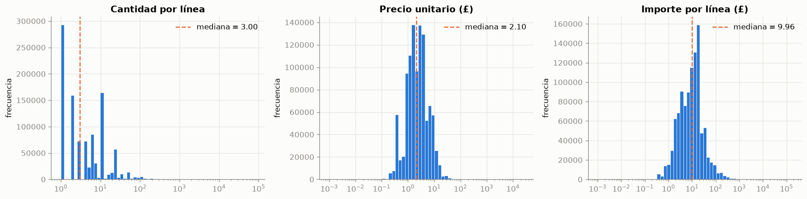

*__Figura 1.-__ Distribución de la cantidad por línea, el precio unitario y el importe por línea de venta, en escala logarítmica. La línea discontinua marca la mediana. Las tres variables tienen colas muy largas: la mayoría de las líneas son pequeñas, pero hay compras mayoristas de varios órdenes de magnitud más, lo que justifica aplicar `log1p` más adelante.*

Cantidad, precio e importe tienen **colas extremadamente largas**: la mayoría de las líneas son pequeñas, pero hay compras mayoristas enormes. Por eso los histogramas usan escala logarítmica, y más adelante se transforman las variables con `log1p`.

### 3.5 Patrones temporales
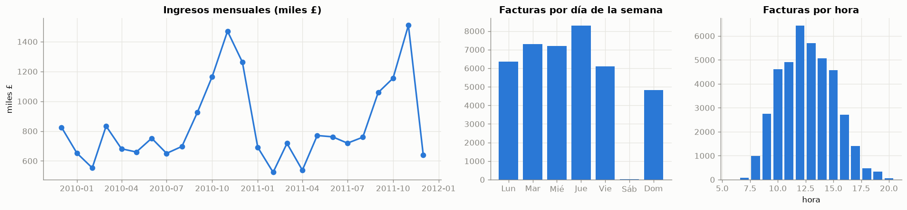

*__Figura 2.-__ Ingresos mensuales (izquierda), número de facturas por día de la semana (centro) y por hora del día (derecha). Se ve un pico estacional en octubre–noviembre de ambos años, ninguna venta en sábado y actividad concentrada entre las 8 y las 17 h, rasgos de un negocio mayorista (B2B).*

- **Estacionalidad navideña muy marcada:** los ingresos casi se duplican entre septiembre y noviembre, tanto en 2010 como en 2011. El último punto (diciembre de 2011) es bajo porque ese mes solo tiene 9 días de datos.
- **No hay ventas los sábados** y casi todas las compras se hacen entre las 8 y las 17 h.
- Esto sugiere un **mayorista que vende a tiendas (B2B)** más que a consumidores finales.

### 3.6 Geografía y productos
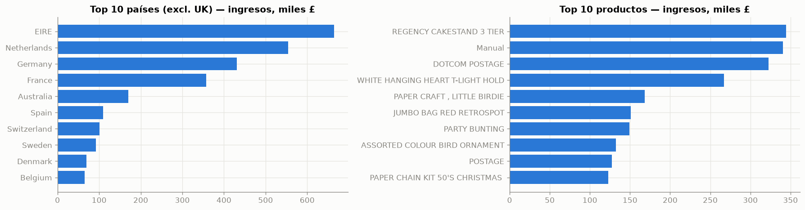

*__Figura 3.-__ Los 10 países con más ingresos sin contar el Reino Unido (izquierda) y los 10 productos con más ingresos (derecha), en miles de libras. El Reino Unido se excluye del gráfico de países porque concentra la gran mayoría de las ventas y taparía al resto.*

El Reino Unido concentra ~92 % de las líneas. Por eso el país **no** se usó como variable de clustering: una variable binaria "es UK" dominaría la agrupación. Se dejó solo para describir los segmentos.

**Conclusiones del EDA que guiaron el resto:**
1. Hay que agregar por cliente.
2. Hay que reducir la asimetría con `log1p`, porque K-Means y GMM son sensibles a los valores extremos.
3. Las cancelaciones se usan como variable.
4. El país se deja fuera del clustering.

---

## 4. Limpieza

Los pasos se aplicaron en orden y se registró cuántas filas eliminaba cada uno:

| Paso | Filas restantes | Eliminadas |
|---|---:|---:|
| Inicial | 1.067.371 | — |
| Quitar duplicados | 1.033.036 | 34.335 |
| Quitar filas sin `Customer ID` | 797.885 | 235.151 |
| Quitar `Price` ≤ 0 | 797.815 | 70 |
| Quitar códigos que no son productos | 794.165 | 3.650 |
| Quitar filas con signo de `Quantity` incoherente | 794.165 | 0 |

*__Tabla 4.-__ Registro de la limpieza: filas que quedan y filas eliminadas en cada paso, aplicados en orden. Al final quedan 794.165 transacciones (74,4 % del original).*

Quedan **794.165 transacciones limpias** (74,4 % del original). En los últimos pasos se eliminan pocas filas porque la mayoría de los registros problemáticos tampoco tenían `Customer ID` y ya habían salido antes.

---

## 5. De transacciones a clientes: ingeniería de variables

**Qué se hizo:** cada cliente se resumió en **9 variables**, siguiendo el enfoque **RFM** (Recency, Frequency, Monetary) ampliado. La fecha de referencia es el 10/12/2011, el día siguiente a la última transacción.

| Variable | Cómo se calcula | Qué representa |
|---|---|---|
| `recency_days` | días desde la última compra | ¿Compra recientemente? |
| `frequency` | n.º de facturas de compra | ¿Cuántas veces compra? |
| `monetary` | ventas − devoluciones (£) | ¿Cuánto gasta en total? |
| `avg_ticket` | ventas / n.º de facturas | ¿Cuánto gasta por pedido? |
| `n_products` | n.º de productos distintos | ¿Qué tan variado es su surtido? |
| `avg_items_per_invoice` | unidades / factura | ¿Compra en volumen (mayorista)? |
| `tenure_days` | días desde la primera compra | Antigüedad como cliente |
| `avg_days_between_purchases` | días entre compras | Ritmo de recompra |
| `return_rate` | facturas canceladas / total | Propensión a devolver |

*__Tabla 5.-__ Las 9 variables construidas para describir a cada cliente (RFM extendido): cómo se calcula cada una y qué aspecto del comportamiento de compra representa.*

- Se descartaron los clientes con gasto neto ≤ 0. Resultado: **5.833 clientes**.
- **27 % de los clientes compró una sola vez.** Para ellos el "tiempo entre compras" no existe, así que se imputó su antigüedad como cota inferior.

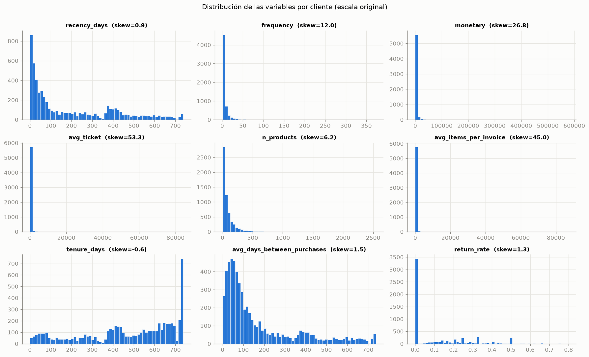

*__Figura 4.-__ Histogramas de las 9 variables por cliente en su escala original, con el coeficiente de asimetría (skew) en el título. Varias variables (frecuencia, gasto, ticket medio, unidades por factura) tienen una asimetría extrema, causada por unos pocos clientes mayoristas.*

**Valores extremos:** hay clientes mayoristas con gastos de hasta £578.000, cuando la mediana es de £844. **No se eliminaron**, porque son clientes reales y probablemente los más importantes. En su lugar se redujo su influencia con `log1p`.

**Correlaciones:**
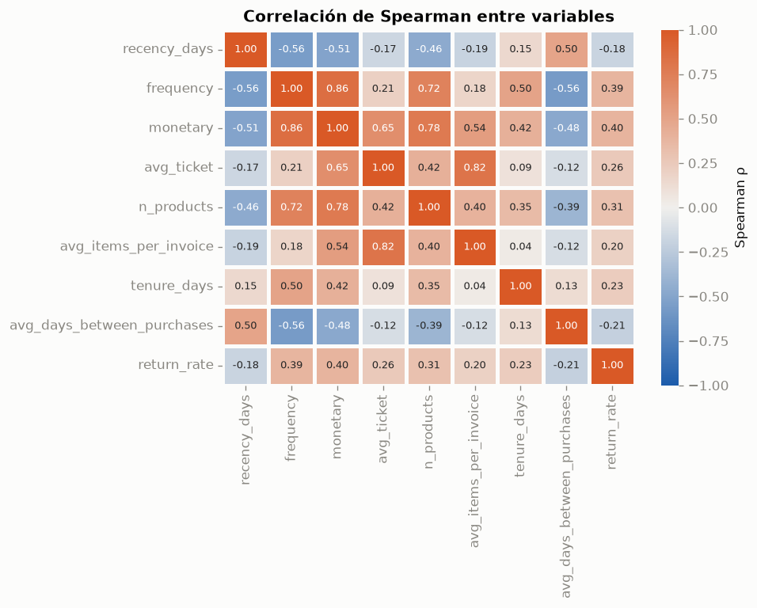

*__Figura 5.-__ Matriz de correlación de Spearman entre las variables por cliente, calculada tras `log1p`. El naranja indica correlación positiva y el azul, negativa. Hay pares muy correlacionados (frecuencia–gasto y ticket medio–unidades por factura), es decir, información redundante que PCA podrá comprimir.*

Hay redundancia fuerte. Por ejemplo, frecuencia y gasto están muy correlacionados, y también ticket medio y unidades por factura. Esto anticipa que **PCA podrá comprimir** los datos sin perder mucha información.

---

## 6. División train/test, transformación y escalado

1. **División 80/20 por cliente** (`random_state=42`): **4.666 clientes en train y 1.167 en test.** No hay fuga de información, porque las variables de cada cliente se calculan solo con sus propias compras.
2. **`log1p` en las variables muy asimétricas** (skew > 1, calculado **solo en train**): frequency, monetary, avg_ticket, n_products, avg_items_per_invoice y avg_days_between_purchases. El efecto es grande: por ejemplo, la asimetría de `avg_ticket` pasa de 48,5 a 0,18. `return_rate` no se transformó porque es una proporción entre 0 y 1.
3. **`StandardScaler` ajustado solo con train** y aplicado a train y test.

**Comprobación de que no hubo fuga:** después de escalar, train tiene media 0 y desviación 1 exactas, mientras que test queda cerca pero no exacto (medias entre −0,06 y 0,10). Eso confirma que el escalador nunca vio los datos de test.

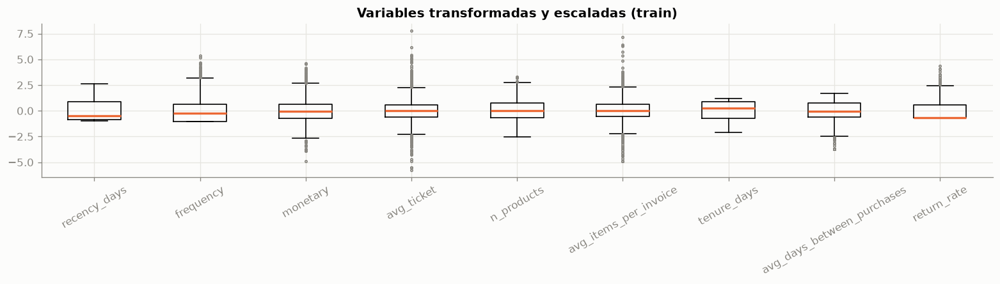

*__Figura 6.-__ Diagramas de caja de las 9 variables de train después de aplicar `log1p` y `StandardScaler`. Todas quedan centradas en 0 y en escalas comparables, de modo que ninguna domina las distancias del clustering solo por sus unidades.*

---

## 7. Etapa 1 — Clustering en el espacio original

### 7.1 Regla para elegir hiperparámetros (fijada de antemano)
1. **K-Means:** se probó k = 2 … 10. **GMM:** se probó k = 2 … 10 × 4 tipos de covarianza (`full`, `diag`, `tied`, `spherical`), es decir, 36 combinaciones. Todo **solo sobre train**.
2. Se descartaron las soluciones con algún cluster menor que el 3 % de los clientes, porque un segmento tan pequeño no sirve en la práctica.
3. Solo se consideró **k ≥ 3** (ver la nota más abajo).
4. Se ordenó cada solución en las tres métricas (Silhouette ↑, Davies-Bouldin ↓, Calinski-Harabasz ↑) y se eligió la de **mejor posición promedio**.

Como no hay etiquetas, ARI y NMI **no se usaron para elegir nada**.

> **Nota sobre k ≥ 3:** con k = 2 las métricas son algo mejores (Silhouette 0,246 frente a 0,231), pero solo separan "clientes de mucho valor" de "clientes de poco valor", lo que no aporta una segmentación útil. Esta decisión es configurable: en `src/config.py`, `K_MIN_SELECTION = 2` usa el criterio puramente métrico.

### 7.2 K-Means
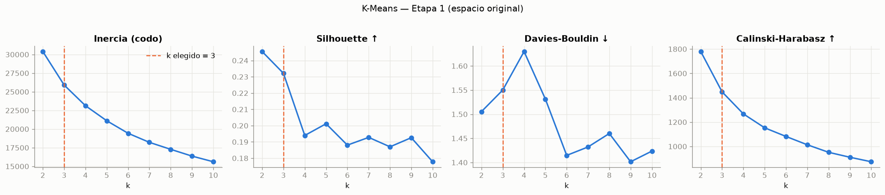

*__Figura 7.-__ Búsqueda del número de clusters de K-Means en la Etapa 1 (espacio original, train). Paneles: inercia (método del codo), Silhouette (↑), Davies-Bouldin (↓) y Calinski-Harabasz (↑) para k = 2 a 10. La línea discontinua marca el k elegido (k = 3). No hay un codo claro y la Silhouette baja de forma continua, señal de que los clientes forman un continuo.*

**Elegido: k = 3.** La Silhouette baja de forma continua al aumentar k, y no hay un "codo" claro en la inercia. Esto ya indica que los clientes no forman grupos muy separados.

### 7.3 GMM
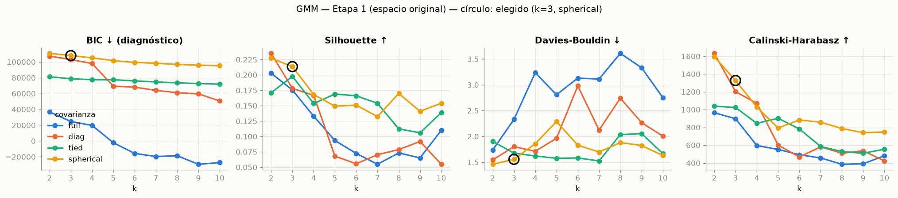

*__Figura 8.-__ Búsqueda de hiperparámetros de GMM en la Etapa 1: BIC, Silhouette, Davies-Bouldin y Calinski-Harabasz según k, con una línea por tipo de covarianza. El círculo marca la configuración elegida (k = 3, `spherical`). En el panel del BIC se ve el colapso de la covarianza `full` a partir de k ≈ 5, causado por los clientes de una sola compra.*

**Elegido: k = 3 con covarianza `spherical`.**

> **Hallazgo importante: el BIC no es fiable aquí.** El BIC es el criterio "natural" para elegir en GMM, pero con covarianza `full` se desploma a valores negativos a partir de k ≈ 5. El motivo: en los clientes de una sola compra se cumple que *recencia = antigüedad = días entre compras*, así que esos clientes quedan sobre un "plano" de menor dimensión. GMM coloca allí gaussianas casi aplanadas, la verosimilitud se dispara y el BIC deja de significar algo. Por eso el BIC se muestra solo como diagnóstico y la selección usa las tres métricas internas, igual que en K-Means.

### 7.4 Resultados de la Etapa 1

| Modelo | Conjunto | Silhouette ↑ | Davies-Bouldin ↓ | Calinski-Harabasz ↑ |
|---|---|---:|---:|---:|
| K-Means (k=3) | train | 0,232 | 1,550 | 1448 |
| K-Means (k=3) | **test** | **0,231** | **1,530** | **364** |
| GMM (k=3, spherical) | train | 0,213 | 1,555 | 1327 |
| GMM (k=3, spherical) | **test** | **0,215** | **1,509** | **339** |

*__Tabla 6.-__ Métricas internas de los modelos finales de la Etapa 1 (espacio original) en train y test. K-Means gana en Silhouette y Calinski-Harabasz y GMM, por poco, en Davies-Bouldin; los valores de train y test son muy similares.*

**Cómo leerlo:**
- **K-Means gana en Silhouette y CH, y GMM gana por poco en DB.** En la práctica son muy parecidos.
- **Train ≈ test:** los segmentos se mantienen con clientes que el modelo no vio. El CH de test es más bajo solo porque esa métrica crece con el número de puntos (test tiene 4 veces menos clientes), así que solo se compara dentro de un mismo conjunto.
- **Una Silhouette de ~0,23 es modesta:** los clientes forman más bien un **continuo** que grupos nítidos. Es normal en datos de comportamiento de clientes.

### 7.5 Los segmentos encontrados

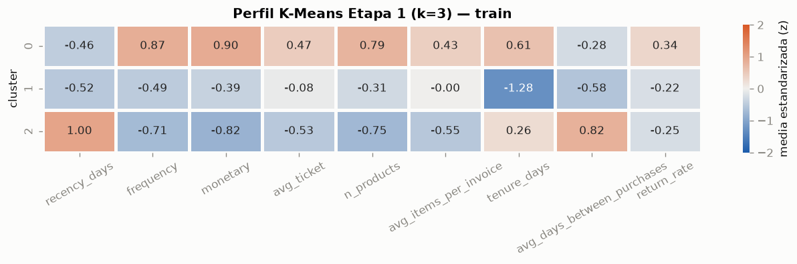

*__Figura 9.-__ Perfil de los 3 clusters de K-Means en la Etapa 1: media estandarizada (z) de cada variable por cluster. El naranja indica valores por encima de la media y el azul, por debajo. El cluster 0 (leales) destaca en frecuencia, gasto y variedad; el cluster 1 (nuevos) tiene poca antigüedad; y el cluster 2 (inactivos) tiene una recencia muy alta.*

*(Mapa de calor: en naranja, valores por encima de la media; en azul, por debajo.)*

| # | Segmento | % clientes | Perfil (valores medianos) | Acción sugerida |
|---|---|---:|---|---|
| 0 | **Leales de alto valor** | ~41 % | última compra hace ~43 días, ~8 pedidos, ~£2.760 gastados, ~117 productos distintos, clientes desde hace ~650 días | Fidelizar, programa VIP, venta cruzada |
| 1 | **Nuevos / en desarrollo** | ~26 % | activos recientemente (~46 días), pero solo ~2 pedidos y ~150 días de antigüedad | Onboarding, incentivar la 2.ª y 3.ª compra |
| 2 | **Inactivos / perdidos** | ~33 % | última compra hace ~410 días, 1 pedido, ~£310 gastados | Reactivación barata o darlos por perdidos |

*__Tabla 7.-__ Los tres segmentos de clientes encontrados por K-Means en la Etapa 1: tamaño, perfil según los valores medianos de las variables originales e interpretación de negocio con una acción sugerida (ilustrativa).*

GMM encuentra **los mismos tres segmentos**, con fronteras algo distintas. Su concordancia con K-Means es **ARI = 0,78**. Además, GMM aporta algo que K-Means no tiene: la **probabilidad de pertenencia**. La probabilidad media es 0,92, y un **5,9 %** de los clientes tiene una asignación dudosa (< 0,6). Esos clientes están "en la frontera" entre segmentos.

---

## 8. Etapa 2 — Clustering en el espacio reducido (PCA)

### 8.1 PCA (ajustado solo con train)
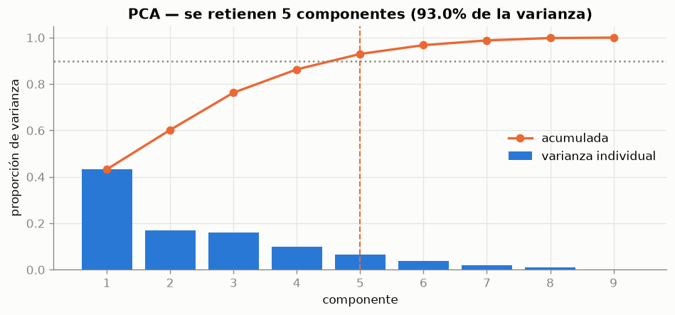

*__Figura 10.-__ Varianza explicada por cada componente principal (barras) y varianza acumulada (línea), con PCA ajustado solo sobre train. La línea punteada marca el umbral del 90 %. Se retienen 5 componentes, que explican el 93 % de la varianza.*

Se retuvo el mínimo número de componentes que explica al menos el 90 % de la varianza: **5 componentes (93 %)**. Se pasa de 9 a 5 dimensiones.

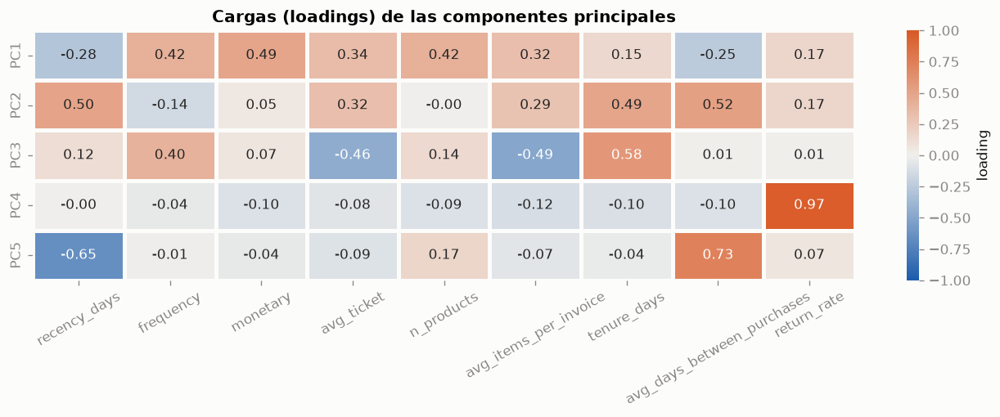

*__Figura 11.-__ Cargas (loadings) de las 5 componentes retenidas sobre las variables originales. PC1 resume el valor y la actividad del cliente, PC2 el eje temporal o de inactividad, PC3 el tamaño de pedido, PC4 las devoluciones y PC5 la recencia frente al ritmo de recompra.*

Qué representa cada componente, según sus cargas:

| Componente | Variables con más peso | Interpretación |
|---|---|---|
| **PC1** (43 %) | gasto 0,49, frecuencia 0,42, n.º productos 0,42 | **Valor y actividad del cliente** |
| **PC2** | recencia 0,50, antigüedad 0,49, días entre compras 0,52 | **Eje temporal / inactividad** |
| **PC3** | antigüedad 0,58 frente a ticket −0,46 y unidades/pedido −0,49 | **Tamaño de pedido** |
| **PC4** | tasa de devolución 0,97 | **Devoluciones** |
| **PC5** | recencia −0,65 frente a días entre compras 0,73 | **Recencia frente a ritmo de recompra** |

*__Tabla 8.-__ Interpretación de las 5 componentes principales retenidas, según las variables con mayor carga (loading) en cada una.*

### 8.2 Mismos modelos, misma búsqueda, misma regla

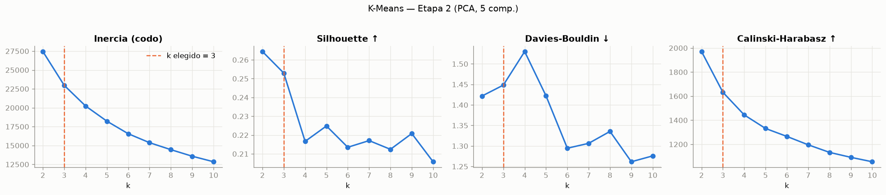

*__Figura 12.-__ Búsqueda del número de clusters de K-Means en la Etapa 2 (espacio PCA de 5 dimensiones, train), con las mismas métricas y la misma regla que en la Etapa 1. Se vuelve a elegir k = 3, y las curvas tienen la misma forma que en el espacio original.*

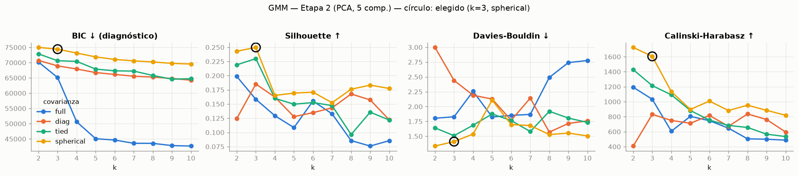

*__Figura 13.-__ Búsqueda de hiperparámetros de GMM en la Etapa 2 (espacio PCA). Se vuelve a elegir k = 3 con covarianza `spherical`. A diferencia de la Etapa 1, el BIC de la covarianza `full` ya no colapsa, porque PCA eliminó las direcciones casi degeneradas.*

**Elegidos de nuevo: K-Means k = 3 y GMM k = 3 `spherical`.** Un detalle interesante: en el espacio PCA el BIC de GMM `full` **ya no colapsa**, porque PCA eliminó las direcciones casi degeneradas que causaban el problema.

### 8.3 Resultados de la Etapa 2

Las métricas Silhouette, DB y CH dependen del espacio en el que se calculan: los mismos grupos dan valores distintos medidos en 5 dimensiones que en 9. Por eso se calcularon de **dos formas**:

| Modelo | Métrica medida en | Silhouette ↑ (test) | DB ↓ (test) | CH ↑ (test) |
|---|---|---:|---:|---:|
| K-Means (k=3) | espacio PCA | 0,251 | 1,438 | 406 |
| K-Means (k=3) | **espacio original** | **0,231** | **1,533** | **364** |
| GMM (k=3, spherical) | espacio PCA | 0,246 | 1,406 | 400 |
| GMM (k=3, spherical) | **espacio original** | **0,225** | **1,501** | **358** |

*__Tabla 9.-__ Métricas en test de los modelos de la Etapa 2, calculadas en el espacio PCA y en el espacio original. La comparación justa con la Etapa 1 es la del espacio original.*

**Cómo leerlo:**
- **En el espacio PCA** todas las métricas "mejoran", pero en parte solo porque se mide en menos dimensiones. Esa comparación es engañosa.
- **En el espacio original**, que es la comparación justa con la Etapa 1:
  - **K-Means queda exactamente igual** (0,231 / 1,53 / 364). Es lo esperable: con el 93 % de la varianza, las distancias apenas cambian. Los clusters son prácticamente los mismos (ARI = 0,99 entre K-Means E1 y K-Means E2).
  - **GMM mejora** (Silhouette 0,215 → 0,225, CH 339 → 358, DB 1,51 → 1,50). Con menos dimensiones estima menos parámetros y se libra de las direcciones degeneradas.
- **Entre modelos:** en la Etapa 2, K-Means y GMM quedan aún más cerca y coinciden más entre sí (ARI 0,78 → 0,87).
- **Tiempo:** la búsqueda de K-Means pasó de 4,1 s a 3,3 s y la de GMM de 25,1 s a 23,6 s. Es una mejora pequeña porque el espacio original ya era chico (9 dimensiones). En cambio, el entrenamiento del modelo final sí es claramente más rápido: entre un 40 % y un 73 % menos (ver Tabla 11, sección 11.1).

### 8.4 Estabilidad de los segmentos
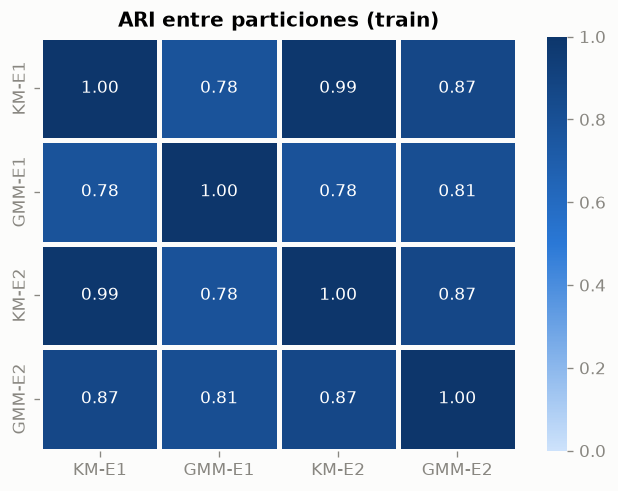

*__Figura 14.-__ Matriz de ARI (Adjusted Rand Index) entre las cuatro particiones de train: K-Means y GMM en las Etapas 1 (E1) y 2 (E2). Un valor de 1 indica particiones idénticas y uno de 0, coincidencia al azar. Todos los pares están entre 0,78 y 0,99, por lo que los segmentos son estables entre modelos y espacios.*

El ARI mide cuánto coinciden dos particiones (1 = idénticas, 0 = coincidencia al azar). Aquí **no** se usa como validación externa, porque no hay etiquetas reales: solo compara las particiones entre sí. Todas las parejas están entre **0,78 y 0,99**, así que **los segmentos son robustos**: aparecen con cualquiera de los dos modelos y en cualquiera de los dos espacios.

---

## 9. Comparación adicional (opcional): UMAP

UMAP es una reducción **no lineal**. Se ajustó con train (5 componentes, `n_neighbors=30`, `min_dist=0`) y se repitió todo el proceso. Eligió **k = 5** en los dos modelos.

| Modelo | Métrica medida en | Silhouette (test) | DB (test) | CH (test) |
|---|---|---:|---:|---:|
| K-Means (k=5) | espacio UMAP | 0,513 | 0,687 | 4373 |
| K-Means (k=5) | **espacio original** | **0,178** | **1,694** | **250** |
| GMM (k=5) | espacio UMAP | 0,511 | 0,684 | 4351 |
| GMM (k=5) | **espacio original** | **0,176** | **1,698** | **249** |

*__Tabla 10.-__ Métricas en test de K-Means y GMM entrenados sobre UMAP, calculadas en el espacio UMAP y en el espacio original. Las métricas en el espacio UMAP están infladas; en el espacio original UMAP es la peor configuración.*

> **Lección:** en su propio espacio UMAP parece excelente (Silhouette 0,51, más del doble que PCA), pero medido en el espacio original es **el peor** de todos. UMAP "compacta" artificialmente los grupos, así que sus métricas internas no son comparables. Por eso siempre hay que evaluar en un espacio común.

---

## 10. Visualización con t-SNE

t-SNE proyecta los datos a 2D **solo para verlos**. No se usó para entrenar ni para elegir nada, porque no puede proyectar datos nuevos y deforma las distancias globales.

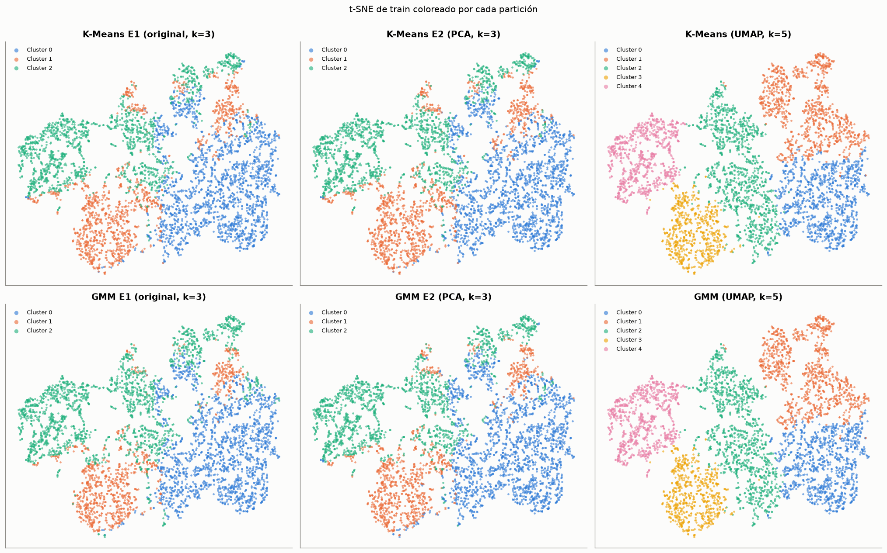

*__Figura 15.-__ Proyección t-SNE en 2D de los clientes de train (solo para visualizar), coloreada con las etiquetas de cada modelo: K-Means arriba y GMM abajo, en los espacios original, PCA y UMAP. Los colores son consistentes: azul = leales de alto valor, naranja = nuevos y verde = inactivos. Las cuatro particiones con k = 3 dibujan prácticamente el mismo mapa, mientras que UMAP (k = 5) divide los grupos en partes más pequeñas.*

Los colores son consistentes en todas las figuras: **azul = leales de alto valor, naranja = nuevos, verde = inactivos**. Se ve que los cuatro modelos con k = 3 (K-Means y GMM, en el espacio original y en PCA) pintan prácticamente el mismo mapa. UMAP (k = 5) divide los grupos en trozos más pequeños.

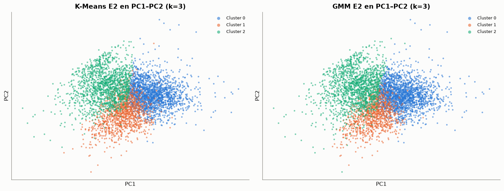

*__Figura 16.-__ Clientes de train en el plano de las dos primeras componentes principales (PC1: valor/actividad; PC2: eje temporal), coloreados con los clusters de K-Means (izquierda) y GMM (derecha) de la Etapa 2. Los segmentos se ordenan sobre todo a lo largo de estos dos ejes, y las fronteras entre ellos son difusas.*

---

## 11. Comparación final

### 11.1 Tabla comparativa obligatoria

Cada celda de métrica muestra **train / test**.

| Modelo | Espacio | Hiperparámetros | N.° grupos | Silhouette ↑ | Davies-Bouldin ↓ | Calinski-Harabasz ↑ | % ruido | Tiempo (s) | ARI vs. original |
|---|---|---|:-:|:-:|:-:|:-:|:-:|:-:|:-:|
| Modelo A: **K-Means** | Original (9 variables) | `n_clusters=3`, `n_init=10`, `init=k-means++` | 3 | 0,232 / 0,231 | 1,550 / 1,530 | 1448,4 / 364,2 | 0 % | 0,065 | — |
| Modelo A: **K-Means** | PCA (5 comp.) | `n_clusters=3`, `n_init=10`, `init=k-means++` | 3 | 0,253 / 0,251 | 1,448 / 1,438 | 1632,1 / 406,4 | 0 % | 0,039 | 0,989 |
| Modelo B: **GMM** | Original (9 variables) | `n_components=3`, `covariance_type='spherical'`, `n_init=3` | 3 | 0,213 / 0,215 | 1,555 / 1,509 | 1327,4 / 339,3 | 0 % | 0,113 | — |
| Modelo B: **GMM** | PCA (5 comp.) | `n_components=3`, `covariance_type='spherical'`, `n_init=3` | 3 | 0,250 / 0,246 | 1,410 / 1,406 | 1604,9 / 400,4 | 0 % | 0,031 | 0,813 |

*__Tabla 11.-__ Tabla comparativa obligatoria: los dos modelos en los dos espacios, con sus hiperparámetros, número de grupos, métricas en train / test, porcentaje de ruido, tiempo de entrenamiento y concordancia (ARI) con el espacio original. Todos usan `random_state=42`.*


**Notas sobre las columnas:**
- **Métricas de las filas PCA:** se calculan en el espacio PCA, que es donde se entrenó el modelo. Medidas sobre el espacio original, las mismas etiquetas dan en test K-Means 0,231 / 1,533 / 363,6 y GMM 0,225 / 1,501 / 358,3 (ver la sección 8.3 y la Figura 17).
- **Calinski-Harabasz:** es menor en test solo porque crece con el número de puntos (test tiene 1.167 clientes y train 4.666). Solo se compara dentro de un mismo conjunto.
- **% ruido:** es 0 % porque ni K-Means ni GMM tienen noción de ruido: asignan todos los puntos a algún cluster. Esta columna solo es relevante para algoritmos como DBSCAN.
- **Tiempo (s):** mediana de 5 entrenamientos del modelo final (solo el `fit`, sin la búsqueda de hiperparámetros). Con PCA el entrenamiento es más rápido: K-Means pasa de 0,065 a 0,039 s (−40 %) y GMM de 0,113 a 0,031 s (−73 %). Son tiempos de milisegundos, así que varían algo entre ejecuciones; el orden de magnitud se mantiene.
- **ARI vs. original:** concordancia entre las etiquetas de train del modelo entrenado en PCA y las del mismo modelo en el espacio original (1 = idénticas). K-Means encuentra prácticamente la misma partición (0,989). GMM cambia algo más (0,813), aunque sigue siendo muy parecida.

### 11.2 Comparación en un espacio común

Todas las configuraciones, en test y medidas en el **espacio original**, que es la comparación justa:

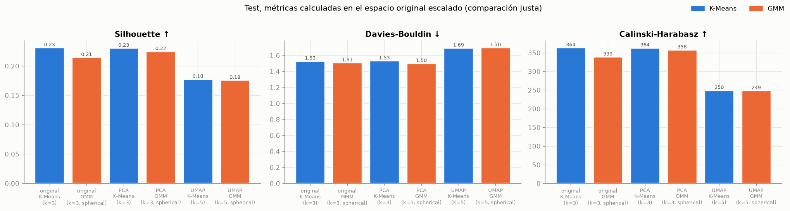

*__Figura 17.-__ Comparación final de las tres métricas en test para todas las configuraciones, todas calculadas en el espacio original escalado para que la comparación sea justa. Azul = K-Means y naranja = GMM. Las configuraciones del espacio original y de PCA obtienen resultados casi iguales; UMAP es la peor cuando se mide en el espacio original.*

| Etapa | Espacio | Modelo | Silhouette ↑ | DB ↓ | CH ↑ |
|---|---|---|---:|---:|---:|
| 1 | original | K-Means (k=3) | **0,231** | 1,530 | **364** |
| 1 | original | GMM (k=3) | 0,215 | 1,509 | 339 |
| 2 | PCA | K-Means (k=3) | **0,231** | 1,533 | **364** |
| 2 | PCA | GMM (k=3) | 0,225 | **1,501** | 358 |
| opc. | UMAP | K-Means (k=5) | 0,178 | 1,694 | 250 |
| opc. | UMAP | GMM (k=5) | 0,176 | 1,698 | 249 |

*__Tabla 12.-__ Resumen de todas las configuraciones (original, PCA y UMAP) con las métricas en test medidas en el espacio original escalado, que es el espacio común para compararlas. En negrita, el mejor valor de cada métrica.*

La tabla completa (train y test, todos los espacios) está en `reports/metricas_comparacion.csv`.

---

## 12. Conclusiones y limitaciones

### Conclusiones
1. **Hay tres segmentos claros y estables:** leales de alto valor (~41 %), nuevos (~26 %) e inactivos (~33 %). Aparecen con los dos algoritmos y en los dos espacios (ARI 0,78–0,99).
2. **K-Means frente a GMM:** K-Means es ligeramente mejor en Silhouette y CH, y GMM en DB. La diferencia es pequeña. GMM añade probabilidades de pertenencia, útiles para detectar clientes en la frontera (~6 %).
3. **Efecto de PCA:** no cambia K-Means, mejora GMM y corrige el problema del BIC. Además permite **interpretar** el espacio (valor, tiempo, tamaño de pedido, devoluciones) con menos dimensiones.
4. **UMAP** muestra por qué no se deben comparar métricas internas calculadas en espacios distintos.
5. **Modelo recomendado: K-Means con k = 3 sobre PCA.** Tiene la misma calidad, usa menos dimensiones, es estable y es fácil de explicar. Si interesa la incertidumbre de cada cliente, conviene GMM sobre PCA.

### Limitaciones
- Silhouette ≈ 0,23: los segmentos son "zonas" de un continuo más que grupos totalmente separados.
- Las métricas internas favorecen clusters redondeados y de tamaño parecido.
- Se excluyó el 22,8 % de las líneas por no tener cliente, y los datos tienen un fuerte sesgo hacia el Reino Unido.
- El tiempo entre compras de los clientes de una sola compra es una aproximación.
- Las variables usan los dos años completos. En un uso real convendría recalcularlas por periodo (por ejemplo, los últimos 12 meses).

---

## 13. Respuestas a las preguntas de análisis

Cada respuesta se apoya en cifras, tablas o figuras de este proyecto. Las preguntas 1, 4, 9 y 10 requerían experimentos adicionales, que están en la sección 10 del cuaderno (*Experimentos complementarios*) y cuyos resultados se guardan en `reports/exp_*.csv`.

### 13.1 Escalado

**¿Por qué es imprescindible escalar?** K-Means y GMM con covarianza `spherical` se basan en **distancias euclídeas**, y en una distancia euclídea cada variable pesa según su varianza. Si una variable tiene valores mucho mayores que las demás, por ejemplo libras frente a proporciones, decide ella sola cómo se forman los grupos.

**Qué pasa con este dataset.** Se entrenaron los dos modelos con el mismo k = 3 en cuatro variantes de preprocesamiento. Las métricas se calcularon en el espacio escalado común, para poder compararlas.

| Variante | Modelo | Variable dominante (% de la varianza total) | Tamaños de los clusters (%) | Silhouette (espacio propio) | Silhouette (espacio común) | ARI vs. elegido |
|---|---|---|---|:-:|:-:|:-:|
| Sin log, sin escalar | K-Means | `monetary` (98 %) | 99,7 / 0,3 / 0,0 | **0,974** | 0,443 | **−0,001** |
| Sin log, sin escalar | GMM | `monetary` (98 %) | 66,3 / 26,9 / 6,8 | 0,520 | 0,147 | 0,275 |
| Sin log, con escalado | K-Means | — (11 % c/u) | 69,7 / 30,0 / 0,3 | 0,262 | 0,187 | 0,312 |
| Sin log, con escalado | GMM | — (11 % c/u) | 86,0 / 12,3 / 1,7 | 0,141 | 0,108 | 0,165 |
| Con log, sin escalar | K-Means | `tenure_days` (54 %) | 41,0 / 30,6 / 28,4 | 0,551 | 0,198 | 0,466 |
| Con log, sin escalar | GMM | `tenure_days` (54 %) | 35,9 / 33,3 / 30,8 | 0,527 | 0,175 | 0,375 |
| **Con log + escalado (elegido)** | K-Means | — (11 % c/u) | 41,2 / 32,6 / 26,2 | 0,232 | 0,232 | 1,000 |
| **Con log + escalado (elegido)** | GMM | — (11 % c/u) | 40,0 / 39,6 / 20,4 | 0,213 | 0,213 | 1,000 |

*__Tabla 13.-__ Efecto del preprocesamiento sobre K-Means y GMM con k = 3 (train). "Espacio propio" es el espacio en el que se entrenó cada variante; "espacio común" es el escalado elegido. El ARI compara cada partición con la elegida.*

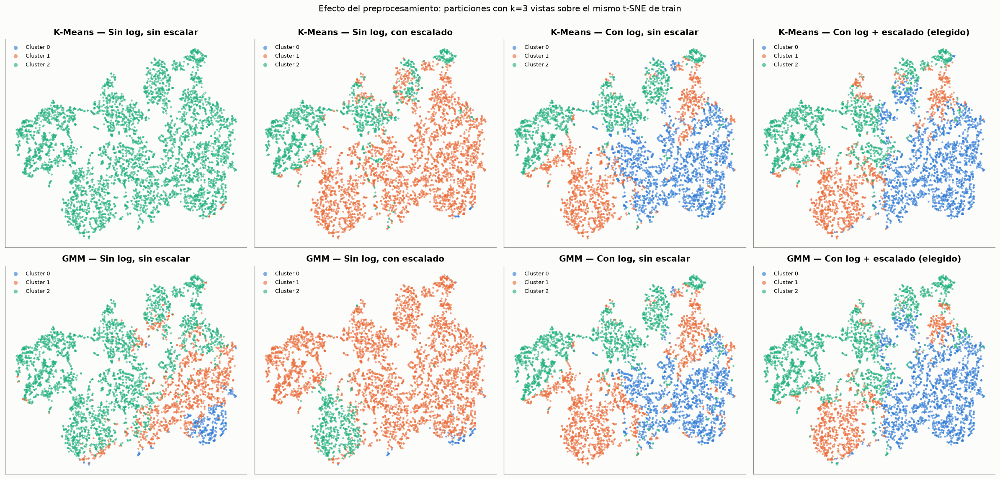

*__Figura 18.-__ Particiones de K-Means (arriba) y GMM (abajo) con k = 3 en las cuatro variantes de preprocesamiento, dibujadas sobre el mismo mapa t-SNE de train. Sin escalar, K-Means pone a casi todos los clientes en un solo grupo (verde), porque solo "ve" el gasto. A medida que se aplica log y escalado, aparecen las tres regiones de la partición elegida.*

**Lectura:**
- **Sin log ni escalado**, `monetary` concentra el **98 % de la varianza**. K-Means solo separa a los **2 clientes más grandes** (gasto mediano de £550.806) y deja al 99,7 % en un mismo grupo. Su Silhouette en su propio espacio es **0,974**, casi perfecta pero **engañosa**: la partición no tiene ninguna relación con la elegida (ARI ≈ 0).
- **Con log pero sin escalar**, la que domina es otra variable: `tenure_days`, que no recibió log y sigue en días (0–738), mientras que las variables con log quedaron en escalas de 0 a ~12. Concentra el 54 % de la varianza, y los grupos pasan a ordenarse sobre todo por antigüedad.
- Solo con **log + escalado** las 9 variables pesan lo mismo (11 % de la varianza cada una).

### 13.2 Elección de hiperparámetros

Este proyecto no usó DBSCAN ni clustering jerárquico, así que no hubo ε, MinPts ni enlace que elegir. Los hiperparámetros fueron **k** en ambos modelos y el **tipo de covarianza** en GMM.

**Los criterios no coincidieron:**
- **Codo (inercia de K-Means):** no hay un codo claro; la inercia baja de forma suave (Figura 7).
- **Silhouette y CH:** ambas son máximas en **k = 2**. En K-Means, k = 2 da una Silhouette de 0,246 y un CH de 1779, frente a 0,232 y 1448 con k = 3.
- **Davies-Bouldin:** prefiere k altos (mínimo 1,40 en k = 9).
- **BIC (GMM):** con covarianza `full` cae a valores negativos (−29.485 en k = 9). Es un artefacto del subespacio degenerado de los clientes de una sola compra (sección 7.3, Figura 8).

**Qué se priorizó y por qué:**
1. **Las tres métricas internas, combinadas por rango promedio**, en lugar de una sola. Como cada métrica favorece un k distinto, combinarlas evita depender del sesgo de una de ellas.
2. **k ≥ 3, por utilidad.** k = 2 solo separa "mucho valor" de "poco valor".
3. **Clusters de al menos el 3 % de train**, para que cada segmento sea accionable.
4. **El BIC se descartó** como criterio porque no era fiable aquí (estaba dominado por el artefacto).

Con esa regla, en GMM ganó `spherical` con k = 3 (Silhouette 0,213, DB 1,555, CH 1327). Las demás covarianzas con k = 3 quedaron por detrás en las tres métricas; por ejemplo, `full` obtuvo 0,175 / 2,329 / 898.

### 13.3 Sesgo de las métricas

**¿Beneficia a algún modelo?** Sí, a **K-Means** y a las variantes de GMM que más se le parecen:
- K-Means minimiza directamente la distancia de cada punto a su centroide, es decir, construye grupos compactos y convexos, que es justo lo que premian Silhouette y Davies-Bouldin. Por eso gana en Silhouette (0,231 frente a 0,215 en test, Tabla 11).
- Dentro de GMM, las métricas eligieron la covarianza **`spherical`**: gaussianas redondas del mismo tipo que los grupos de K-Means. Las covarianzas más flexibles, que permiten grupos alargados (`full`, `diag`), puntuaron peor. Con k = 3, `full` obtuvo una Silhouette de 0,175 frente a 0,213 de `spherical` (sección 7.3). Es decir, **el sesgo de las métricas empujó a GMM a comportarse como K-Means**, y eso explica en parte la alta concordancia entre ambos (ARI 0,78–0,87, Figura 14).

**¿Las métricas y la inspección visual cuentan la misma historia?** Sí:
- Una Silhouette de ~0,23 dice "hay estructura, pero los grupos no están bien separados".
- El gráfico PC1–PC2 (Figura 16) muestra exactamente eso: una nube continua dividida en tres zonas sin huecos entre ellas.
- El t-SNE (Figura 15) muestra las tres regiones como zonas coherentes, pero con fronteras mezcladas.

La única "historia distinta" la cuenta UMAP: en su propio espacio la Silhouette es 0,51, mientras que en el espacio original es 0,18 (sección 9). Ese desacuerdo se explica porque UMAP separa artificialmente los grupos (ver 13.11).

### 13.4 Ruido y atípicos

**No se usó DBSCAN**, así que el porcentaje de ruido es 0 %: K-Means y GMM asignan todos los puntos a algún cluster (Tabla 11).

**Cómo afectan los atípicos a K-Means y GMM.** Los dos modelos usan medias y varianzas, que son muy sensibles a los valores extremos:
- **Sin tratar los atípicos** (sin log, Tabla 13), K-Means **gasta un cluster entero en ellos**: solo con escalado, el cluster más pequeño tiene **13 clientes con un gasto mediano de £168.504**, y sin escalar, solo 2 clientes. En GMM aparecen componentes de 1,7 % a 6,8 % dedicados a mayoristas.
- **Con `log1p`** (la solución elegida), los atípicos ya no forman grupos propios. De los **47 clientes del 1 % con más gasto**, **46 quedan en el segmento de leales de alto valor** tanto en K-Means como en GMM. Se integran en el segmento que les corresponde en lugar de distorsionar la partición.
- **Quiénes son los atípicos que quedan:** el 1 % de los clientes más lejanos a su centroide en K-Means tiene un gasto mediano de **£4.255**, frente a £848 del cliente típico, y compra **887 unidades por pedido** frente a 155. Son **mayoristas**. Su distancia al centroide llega a 10,99, frente a una mediana de 2,03. GMM identifica prácticamente a los mismos clientes como los menos verosímiles: **40 de 47 coinciden**.

Se decidió **no eliminarlos**, porque son clientes reales y probablemente los más valiosos, y reducir su influencia con `log1p`.

### 13.5 Componentes principales

Se conservaron **5 componentes** que retienen el **93,0 %** de la varianza: PC1 43,2 %, PC2 17,0 %, PC3 16,1 %, PC4 10,0 % y PC5 6,7 % (Figuras 10 y 11, Tabla 8).

- **PC1 (43,2 %): "valor y actividad del cliente".** Pesos: gasto 0,49, frecuencia 0,42, n.º de productos 0,42, ticket medio 0,34 y recencia −0,28. Un valor alto de PC1 corresponde a un cliente que compra a menudo, gasta mucho, tiene un surtido amplio y compró hace poco. Es esencialmente un **índice RFM**.
- **PC2 (17,0 %): "eje temporal o de inactividad".** Pesos: recencia 0,50, antigüedad 0,49 y días entre compras 0,52. Un valor alto corresponde a un cliente antiguo que hace tiempo que no compra y que, cuando compraba, lo hacía muy espaciado: el perfil de un **cliente perdido**.

En el gráfico PC1–PC2 (Figura 16), los tres segmentos se ordenan justamente sobre estos dos ejes:
- leales: PC1 alto;
- inactivos: PC1 bajo y PC2 alto;
- nuevos: PC1 bajo y PC2 bajo (poca antigüedad).

### 13.6 Efecto de la reducción

**En el espacio PCA, todas las métricas mejoraron en los dos modelos** (test, Tabla 11):
- K-Means: Silhouette 0,231 → 0,251, DB 1,530 → 1,438, CH 364 → 406.
- GMM: 0,215 → 0,246, 1,509 → 1,406, 339 → 400.

**Causas:**
- **Redundancia:** varias variables miden casi lo mismo. Tras el log, frecuencia y gasto tienen una correlación de Pearson ≈ 0,85 (ver también la matriz de Spearman, Figura 5). En el espacio original esa información "cuenta dos veces" en las distancias. PCA la concentra en PC1.
- **Ruido:** las 4 componentes descartadas solo explican el 7 % de la varianza. Son direcciones con poca estructura que, en 9D, añaden dispersión dentro de los clusters. Al quitarlas, los grupos quedan más compactos y la Silhouette sube.
- **Dimensiones degeneradas:** las direcciones casi sin varianza que creaban los clientes de una sola compra hacían colapsar a GMM `full` (BIC −29.485). En el espacio PCA el BIC ya no colapsa (Figura 13).
- **Maldición de la dimensionalidad:** aquí su efecto es **pequeño**. Con 9 variables las distancias todavía discriminan bien, y por eso la mejora real (medida en el espacio original, ver 13.7) es nula para K-Means y modesta para GMM. GMM se beneficia más porque en 5D estima menos parámetros.

### 13.7 Comparación justa

**No es válido** comparar directamente una Silhouette calculada en 9D con otra calculada en 5D. La Silhouette se construye con distancias, y las distancias cambian al eliminar dimensiones. Una parte de la "mejora" se debe solo a que en 5D hay menos dispersión.

Por eso se **recalcularon las métricas en el espacio original** usando las etiquetas obtenidas tras la reducción (sección 8.3, Tabla 9, Figura 17). En test, las métricas de la Etapa 2 (Silhouette / DB / CH) quedan así:
- **K-Means:** en el espacio PCA, 0,251 / 1,438 / 406. Medido en el **espacio original**, **0,231 / 1,533 / 364**, idéntico a la Etapa 1 (0,231 / 1,530 / 364).
- **GMM:** en el espacio PCA, 0,246 / 1,406 / 400. Medido en el **espacio original**, **0,225 / 1,501 / 358**, frente a 0,215 / 1,509 / 339 en la Etapa 1.

**¿Cambia la conclusión?** Sí, en parte:
- Mirando solo el espacio PCA, parecería que PCA mejora claramente a los dos modelos.
- En el espacio común se ve que **K-Means no mejora nada**: encuentra los mismos grupos (ARI 0,989), y toda su "mejora" era un efecto del espacio de medida.
- **GMM sí mejora de verdad**, aunque menos de lo que parecía (Silhouette +0,010 en lugar de +0,031).
- El orden entre modelos (K-Means ≥ GMM en Silhouette y CH) **no cambia**.
- El caso extremo es UMAP: en su espacio parece el mejor (0,51) y en el espacio común es el peor (0,18).

### 13.8 Cambio en las asignaciones

ARI entre la partición en el espacio original y la partición en PCA, en train (Tabla 11, Figura 14):
- **K-Means: ARI = 0,989.** Prácticamente la misma partición: los tamaños de los segmentos pasan de 41,2 / 26,2 / 32,6 % a 41,1 / 26,1 / 32,7 %, y solo cambia de grupo un puñado de clientes de las fronteras. Con el 93 % de la varianza, los centroides y las distancias casi no se alteran.
- **GMM: ARI = 0,813.** Concordancia alta, pero hay movimiento real. El segmento de inactivos pasa del 40,0 % al 34,3 % y el de leales del 39,6 % al 43,4 %, es decir, **~6 % de los clientes** se reasignan, sobre todo de inactivos a leales y nuevos. Al eliminar las direcciones degeneradas, cambia la forma en que GMM reparte a los clientes de una sola compra, que son justo los que estaban en el subespacio problemático.

### 13.9 Estabilidad

Se repitió cada modelo con **10 semillas** distintas y con **20 submuestras del 80 %** de train, y se comparó cada resultado con la partición de referencia mediante el ARI.

| Modelo | Espacio | 10 semillas (`n_init` elegido) | 10 semillas (`n_init=1`) | 20 submuestras del 80 % |
|---|---|:-:|:-:|:-:|
| K-Means | Original | 0,998 (mín. 0,995) | 0,942 (mín. **0,447**) | **0,977** (mín. 0,919) |
| K-Means | PCA | 0,997 (mín. 0,994) | 0,997 (mín. 0,995) | **0,978** (mín. 0,950) |
| GMM | Original | 0,949 (mín. 0,504) | 0,949 (mín. 0,504) | 0,871 (mín. **0,291**) |
| GMM | PCA | 0,996 (mín. 0,994) | 0,993 (mín. 0,990) | 0,834 (mín. **0,149**) |

*__Tabla 14.-__ Estabilidad de cada modelo: ARI medio (y mínimo) respecto de la partición de referencia.*

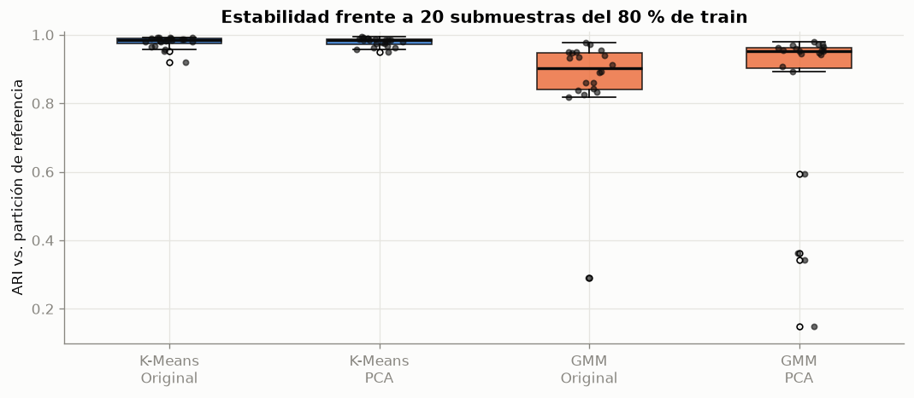

*__Figura 19.-__ ARI respecto de la partición de referencia en 20 submuestras del 80 % de train. Cada punto es una submuestra. K-Means (azul) es muy estable en los dos espacios. GMM (naranja) suele reproducir la partición (mediana ≈ 0,90–0,95), pero en algunas submuestras converge a una solución bastante distinta (ARI de 0,15 a 0,60).*

**¿Los grupos se mantienen?** Con K-Means, sí: con submuestras distintas se recupera casi la misma partición (ARI ≈ 0,98). Con GMM, en general sí, pero no siempre.

**K-Means es el modelo más estable.** Las razones:
- Tiene **menos parámetros** (solo los centroides), mientras que GMM estima además varianzas y pesos de cada componente. Con datos que forman un **continuo** (Silhouette ≈ 0,23), hay varias formas casi igual de verosímiles de repartir a los clientes, y pequeñas variaciones en los datos llevan a GMM a una u otra.
- Con `n_init=10`, K-Means **siempre** encuentra el mismo óptimo. Con una sola inicialización (`n_init=1`) en el espacio original, a veces cae en un mínimo local (ARI mínimo 0,447). Esto justifica usar varias inicializaciones.
- En PCA, K-Means es estable incluso con `n_init=1`: el espacio reducido es más "liso" y tiene menos mínimos locales.

### 13.10 Costo computacional

Se midió el tiempo de entrenamiento, de predicción sobre test y de cálculo de la Silhouette (mediana de varias repeticiones), con el train real y con train replicado 4 y 10 veces con un pequeño ruido. Los resultados completos están en `reports/exp_costo.csv`.

**Cambio con la reducción:**
- Con el tamaño actual, PCA reduce el entrenamiento entre un **55 % y un 75 %** (K-Means 0,085 → 0,038 s; GMM 0,102 → 0,025 s).
- La predicción de los 1.167 clientes de test tarda menos de **0,4 ms** (K-Means 0,39 → 0,36 ms; GMM 0,31 → 0,17 ms).
- La Silhouette tarda ~0,34 s en todos los casos: depende del número de clientes, no del espacio en que se entrenó el modelo.
- Todos estos tiempos son de **milisegundos**: con 9 variables, la reducción apenas importa en términos absolutos.

**Si el dataset tuviera 100 veces más observaciones (~470.000 clientes en train):**
- **Entrenamiento y predicción** crecen de forma aproximadamente **lineal**: con 10 veces más datos, entrenar tarda entre 0,5 y 1,3 s. El factor de aumento (de ×10 a ×31) es algo mayor que 10 porque los tiempos de partida son tan pequeños que pesa la parte fija. Extrapolando a 100×, entrenar costaría del orden de **10–40 s** por modelo. Es asumible.
- **El cuello de botella sería la Silhouette**, que compara todos los pares de puntos: su tiempo crece aproximadamente con **n²**. Con 4 veces más datos pasó de ~0,34 s a ~4,8 s, unas 14 veces más (exponente medido: 1,9). Pasaría de 0,34 s a unos **3.400 s (~57 min) por cálculo**. La búsqueda de hiperparámetros calcula 45 Silhouettes (9 de K-Means y 36 de GMM), lo que sumaría **~42 horas** por etapa.
- **Cómo se abordaría:**
  - calcular la Silhouette sobre una muestra (`silhouette_score(..., sample_size=10_000)`);
  - usar DB y CH, que son lineales en n;
  - usar `MiniBatchKMeans` para entrenar.
  - En ese escenario, PCA ayudaría más en **memoria** que en tiempo.

### 13.11 Visualización no lineal

En este proyecto los grupos **sí** se ven como regiones distintas en t-SNE (Figura 15) y en UMAP, mientras que en PCA (Figura 16) se ven como una nube continua sin huecos.

**Qué se puede concluir:**
- Que los segmentos encontrados en 9D son **coherentes localmente**: clientes vecinos tienden a compartir segmento, porque cada color ocupa regiones compactas del t-SNE.
- Que las cuatro particiones con k = 3 son muy parecidas, porque pintan el mismo mapa.

**Qué no se puede concluir:**
- Que los grupos estén **realmente separados**: los huecos y las "islas" del t-SNE dependen de la perplejidad y son en parte artificiales.
- Nada sobre las **distancias entre grupos** ni sobre sus **tamaños o densidades** relativas: t-SNE no conserva distancias globales ni densidades.
- Que exista "el número correcto" de grupos a partir del número de islas.

**Por qué no usar t-SNE como entrada de un algoritmo de clustering:**
1. **No tiene `transform`**, así que no se pueden proyectar clientes nuevos. Eso rompe el protocolo train/test que exige el enunciado.
2. Es **estocástico y depende de la perplejidad**: otra semilla u otro valor de perplejidad cambian el mapa.
3. **Deforma las distancias y las densidades**, que son exactamente lo que usan K-Means, GMM y DBSCAN.
4. Produce métricas internas **infladas**. Este proyecto lo muestra con UMAP, que se considera más fiel a la estructura global que t-SNE y aun así infla las métricas: los mismos modelos obtienen una Silhouette de 0,51 en su espacio, pero de 0,18 cuando se mide en el espacio original (sección 9, Tabla 10).

### 13.12 Recomendación final

**Configuración recomendada: K-Means con k = 3 sobre PCA (5 componentes).**
- **Calidad:** igual a la mejor configuración medida en el espacio común (Silhouette 0,231, DB 1,533, CH 364 en test; Tabla 9), con métricas de test iguales a las de train.
- **Estabilidad:** la mayor de todas (ARI 0,978 con submuestras y 0,997 con semillas, incluso con `n_init=1`; Tabla 14).
- **Costo:** entrenamiento más rápido que en el espacio original (Tabla 11).
- **Interpretabilidad:** los ejes tienen sentido de negocio (PC1 = valor, PC2 = inactividad), y los tres segmentos (leales de alto valor, nuevos e inactivos) se explican y se convierten en acciones fácilmente.
- Si se necesita **saber qué tan segura es la asignación** de cada cliente, se puede usar GMM como complemento, porque da probabilidades de pertenencia (~6 % de los clientes con asignación dudosa). Pero su menor estabilidad (Figura 19) desaconseja usarlo como segmentación principal.

**Limitaciones:**
1. **Grupos poco separados:** con una Silhouette de ~0,23, los segmentos son zonas de un continuo y los clientes de las fronteras están mal definidos.
2. **Variables estáticas:** se calcularon sobre los dos años completos, así que no reflejan cambios de comportamiento en el tiempo.
3. **Datos sesgados o incompletos:** se excluyó el 22,8 % de las líneas por no tener `Customer ID`, y el ~92 % de las líneas es del Reino Unido.
4. **Clientes de una sola compra (27 %):** su tiempo entre compras se imputó, y crean un subespacio degenerado que afecta a GMM.
5. **Validación:** solo hay métricas internas. No se sabe si los segmentos predicen algo útil para el negocio.

**Con más datos o más tiempo:**
- **Validar en el tiempo:** construir las variables con 2010, segmentar y comprobar con 2011 si, por ejemplo, los "inactivos" realmente no vuelven a comprar y los "nuevos" crecen.
- **Añadir variables** de categoría de producto (qué compra cada cliente) y de estacionalidad.
- **Probar HDBSCAN o clustering aglomerativo** para detectar explícitamente a los mayoristas como grupo o como ruido.
- **Elegir k por estabilidad** (bootstrap) además de por métricas internas.
- Con más volumen de datos, usar Silhouette muestreada y `MiniBatchKMeans` (ver 13.10).

---

## 14. Cómo reproducirlo

```bash
# 1. Crear el entorno e instalar dependencias
python3 -m venv .venv
.venv/bin/pip install -r requirements.txt
.venv/bin/python -m ipykernel install --user --name online-retail --display-name "Python (online-retail)"

# 2. Ejecutar el cuaderno completo (~3 minutos)
cd notebooks
../.venv/bin/jupyter nbconvert --to notebook --execute --inplace \
    --ExecutePreprocessor.timeout=1800 --ExecutePreprocessor.kernel_name=online-retail \
    proyecto_clustering.ipynb
```

El CSV debe estar en `dataset/online_retail_II.csv`. Las figuras se regeneran en `reports/figures/`.
