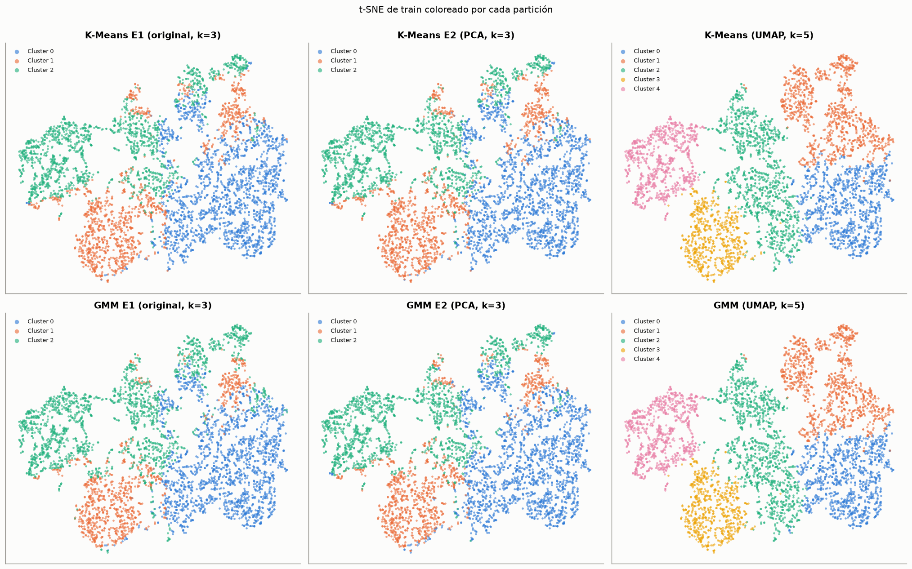

# Segmentación de clientes con clustering — Online Retail II


> **⚠️ Proyecto académico** de la asignatura de Machine Learning (cierre del Bloque 3), con fines exclusivamente formativos. Usa el dataset público Online Retail II (UCI), sin relación con la empresa que lo generó. Los segmentos y recomendaciones son interpretaciones ilustrativas.

Segmentación no supervisada de **5.833 clientes** de un mayorista online del Reino Unido a partir de **~1,07 millones de transacciones** (2009–2011). Se comparan dos algoritmos de familias distintas, **K-Means** y **GMM**, en el espacio original de variables y en un espacio reducido con **PCA**.

📄 **El análisis completo, paso a paso y con todas las figuras, está en [`INFORME.md`](INFORME.md).**

---

## Resultados principales

Los dos modelos, en los dos espacios, encuentran **los mismos tres segmentos** de clientes:

| Segmento | % clientes | Perfil típico |
|---|:-:|---|
| 🔵 **Leales de alto valor** | ~41 % | compran a menudo (~8 pedidos), gastan ~£2.760, última compra hace ~43 días |
| 🟠 **Nuevos / en desarrollo** | ~26 % | activos recientemente, pero con solo ~2 pedidos y ~150 días de antigüedad |
| 🟢 **Inactivos / perdidos** | ~33 % | una sola compra, hace más de un año, ~£310 de gasto |



Métricas en el conjunto de **test**, todas medidas en el espacio original escalado para que la comparación sea justa:

| Modelo | Espacio | Silhouette ↑ | Davies-Bouldin ↓ | Calinski-Harabasz ↑ | ARI vs. original |
|---|---|:-:|:-:|:-:|:-:|
| K-Means (k=3) | Original (9 variables) | **0,231** | 1,530 | **364** | — |
| K-Means (k=3) | PCA (5 comp., 93 % var.) | **0,231** | 1,533 | **364** | 0,989 |
| GMM (k=3, spherical) | Original (9 variables) | 0,215 | 1,509 | 339 | — |
| GMM (k=3, spherical) | PCA (5 comp., 93 % var.) | 0,225 | **1,501** | 358 | 0,813 |

**Conclusiones clave:**
- **PCA no cambia K-Means** (ARI 0,989 con el espacio original) y **mejora algo a GMM**. Además elimina un subespacio degenerado que hacía colapsar el BIC.
- **K-Means es más estable** que GMM: con submuestras distintas recupera la misma partición (ARI ≈ 0,98), mientras que GMM a veces converge a otra solución.
- Las métricas medidas **en el espacio reducido engañan**. UMAP obtiene una Silhouette de 0,51 en su propio espacio, pero de 0,18 en el original.
- **Configuración recomendada:** K-Means con k = 3 sobre PCA.

---

## Metodología

```
Transacciones ──► Limpieza ──► 9 variables por cliente (RFM extendido) ──► log1p + StandardScaler
                                                                              │
                         ┌────────────────────────────────────────────────────┤
                         ▼                                                    ▼
              Etapa 1: espacio original                         Etapa 2: PCA (5 componentes)
              K-Means · GMM                                     K-Means · GMM  (+ UMAP opcional)
                         └───────────────► Silhouette · Davies-Bouldin · Calinski-Harabasz ◄┘
                                           en train y test, y en un espacio común
```

- División train/test 80/20 **por cliente**, con semilla fija (`SEED = 42`).
- Transformación, escalado, PCA y UMAP **ajustados solo con train**.
- Hiperparámetros (k y tipo de covarianza) elegidos con una regla explícita que usa solo métricas internas.
- t-SNE se usa **solo para visualizar**.
- Experimentos adicionales: efecto del escalado y de los atípicos, estabilidad con semillas y submuestras, y costo computacional.

---

## Estructura del repositorio

```
├── INFORME.md                          # informe completo
├── notebooks/
│   └── proyecto_clustering.ipynb       # análisis ejecutable de principio a fin
├── src/
│   ├── config.py                       # semilla, rutas e hiperparámetros de búsqueda
│   ├── features.py                     # carga, limpieza y variables por cliente
│   ├── evaluation.py                   # métricas, búsqueda y selección de modelos
│   └── plotting.py                     # estilo de gráficos
├── reports/
│   ├── figures/                        # figuras generadas
│   └── *.csv                           # tablas de métricas y experimentos
├── dataset/                            # (no incluido, ver abajo)
└── requirements.txt
```

---

## Cómo ejecutarlo

**1. Clonar e instalar dependencias** (Python 3.12):

```bash
git clone <url-del-repositorio>
cd online_retail
python3 -m venv .venv
.venv/bin/pip install -r requirements.txt
.venv/bin/python -m ipykernel install --user --name online-retail --display-name "Python (online-retail)"
```

**2. Descargar el dataset.** No se incluye en el repositorio porque pesa ~95 MB. Descárgalo desde el [UCI Machine Learning Repository](https://archive.ics.uci.edu/dataset/502/online+retail+ii) y guárdalo como:

```
dataset/online_retail_II.csv
```

El código espera un único CSV con las dos hojas del Excel original (2009-2010 y 2010-2011) unidas y con las columnas `Invoice, StockCode, Description, Quantity, InvoiceDate, Price, Customer ID, Country`.

**3. Ejecutar el cuaderno** (~3–5 minutos):

```bash
cd notebooks
../.venv/bin/jupyter nbconvert --to notebook --execute --inplace \
    --ExecutePreprocessor.timeout=3000 --ExecutePreprocessor.kernel_name=online-retail \
    proyecto_clustering.ipynb
```

También se puede abrir con `jupyter lab` y elegir el kernel **Python (online-retail)**. Las figuras y tablas se regeneran en `reports/`.

---

## Dataset

Chen, D. (2012). *Online Retail II* [Dataset]. UCI Machine Learning Repository. <https://archive.ics.uci.edu/dataset/502/online+retail+ii>
